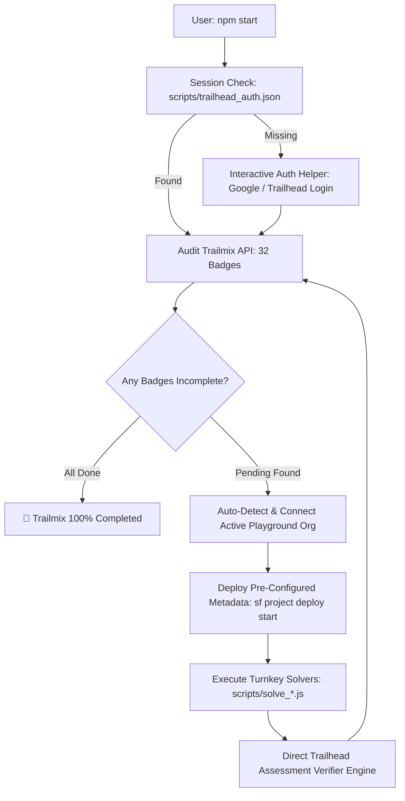

# Automated Salesforce Developer Catalyst - V3.0 🚀

[](https://trailhead.salesforce.com/users/trjha3/trailmixes/salesforce-developer-catalyst-v-3-0)
[-success?style=for-the-badge&logo=trailhead&logoColor=white)](https://trailhead.salesforce.com/users/trjha3/trailmixes/salesforce-developer-catalyst-v-3-0)
[](https://nodejs.org/)
[](https://developer.salesforce.com/tools/salesforcecli)
[](https://opensource.org/licenses/MIT)

An end-to-end automated orchestration toolkit and complete source metadata repository designed to help developers and students seamlessly complete all **32 Badges (Modules & Projects)** of the **[Salesforce Developer Catalyst - V3.0](https://trailhead.salesforce.com/users/trjha3/trailmixes/salesforce-developer-catalyst-v-3-0)** Trailmix.

---

## 🏗️ Architecture & Execution Flow



---

## ✨ Features

- 🎯 **Turnkey Master Runner (`npm start`)**: Interactive command-line orchestrator that automatically audits Trailmix progress, connects your active hands-on org, deploys metadata, and executes badge solvers.
- ⚡ **Auto-Detection of Hands-on Org**: Dynamically queries the Trailhead launch session to link your live Playground or Developer Edition org to the Salesforce CLI (`sf`) without manually copying credentials or usernames.
- 🧩 **Complete Pre-configured Metadata (`force-app/`)**: Full source-tracked metadata for all hands-on projects, including custom objects, lookup relationships, screen flows, validation rules, Apex triggers, permission sets, and custom page layouts.
- 🧠 **Instant Quiz & Challenge Solver**: Built-in verification engine with exact answer keys and assessment automation for all 32 knowledge checks and multiple-choice quizzes.
- 🛡️ **Rate-Limit & Anti-Detection Protected**: Engineered with realistic assessment pacing, stealth browser evasion, and exponential backoff to respect Trailhead backend rate limits and prevent Google login warnings.
- 🔒 **Zero-Leak Privacy Architecture**: No credentials, access tokens, personal emails, or scratch logs are ever tracked or committed to Git.

---

## 📋 Prerequisites

Before running the orchestrator, ensure the following tools are installed:

1. **[Node.js](https://nodejs.org/)** (v18.0.0 or higher)
   ```bash
   node --version
   ```
2. **[Git](https://git-scm.com/)**
   ```bash
   git --version
   ```
3. **[Salesforce CLI (`sf`)](https://developer.salesforce.com/tools/salesforcecli)**
   ```bash
   sf --version
   ```
4. **Google Chrome** (used for one-time interactive login)

---

## 🚀 Quickstart Guide

### 1. Clone & Install
```bash
git clone https://github.com/yash-shende99/Automated-Salesforce-Developer-Catalyst--V3.0.git
cd Automated-Salesforce-Developer-Catalyst--V3.0
npm install
```

### 2. Authenticate to Trailhead
Run the anti-detection auth helper to capture your active Trailhead session:
```bash
npm run auth
```
- A clean Chrome window will open.
- Log in to your Trailhead / Google account normally.
- Once logged in, the window closes automatically, saving your local session safely in `scripts/trailhead_auth.json` (strictly ignored by `.gitignore`).

### 3. Launch the Master Orchestrator
```bash
npm start
```
From the interactive menu:
- Select **`1`** to audit your live 32-badge Trailmix progress.
- Select **`2`** to automatically deploy required project metadata and solve all pending badges!
- Select **`3`** to re-sync your active Trailhead Playground with the Salesforce CLI.
- Select **`4`** to refresh your session if cookies expire.

---

## 🏆 Curriculum & Badge Matrix (32 of 32 Completed)

| # | Title | Category | Type | Status |
|:---:|:---|:---:|:---:|:---:|
| 1 | **Your Guide to Trailhead** | Fundamentals | Module | ✅ Verified |
| 2 | **Agentforce 360 Platform Basics** | Fundamentals | Module | ✅ Verified |
| 3 | **Lightning Experience Customization** | Administration | Module | ✅ Verified |
| 4 | **Data Modeling** | Administration | Module | ✅ Verified |
| 5 | **Picklist Administration** | Administration | Module | ✅ Verified |
| 6 | **Duplicate Management** | Data Quality | Module | ✅ Verified |
| 7 | **Customize a Salesforce Object** | Administration | Project | ✅ Verified |
| 8 | **Formulas and Validations** | Process Logic | Module | ✅ Verified |
| 9 | **Improve Data Quality for a Recruiting App** | Data Quality | Project | ✅ Verified |
| 10 | **Customize the User Interface for a Recruiting App** | UI Design | Project | ✅ Verified |
| 11 | **Flow Builder Basics** | Process Automation | Module | ✅ Verified |
| 12 | **Create a Screen Flow That Checks for Duplicates** | Process Automation | Project | ✅ Verified |
| 13 | **Screen Flows** | Process Automation | Module | ✅ Verified |
| 14 | **Lightning App Builder** | UI Design | Module | ✅ Verified |
| 15 | **Approve Records with Approval Processes** | Process Automation | Module | ✅ Verified |
| 16 | **Automate Business Processes for a Recruiting App** | Process Automation | Project | ✅ Verified |
| 17 | **Build a Discount Approval Process** | Process Automation | Project | ✅ Verified |
| 18 | **Quick Start: Lightning App Builder** | UI Design | Project | ✅ Verified |
| 19 | **Data Management** | Data Architecture | Module | ✅ Verified |
| 20 | **Event Monitoring** | Security | Module | ✅ Verified |
| 21 | **Data Security** | Security | Module | ✅ Verified |
| 22 | **Keep Data Secure in a Recruiting App** | Security | Project | ✅ Verified |
| 23 | **Shield Platform Encryption** | Security | Module | ✅ Verified |
| 24 | **API Basics** | Developer & APIs | Module | ✅ Verified |
| 25 | **360 Platform API Basics** | Developer & APIs | Module | ✅ Verified |
| 26 | **Apex Basics for Admins** | Apex Development | Module | ✅ Verified |
| 27 | **SOQL for Admins** | Apex Development | Module | ✅ Verified |
| 28 | **Apex Triggers** | Apex Development | Module | ✅ Verified |
| 29 | **Apex Testing** | Apex Development | Module | ✅ Verified |
| 30 | **Asynchronous Apex** | Apex Development | Module | ✅ Verified |
| 31 | **Apex Integration Services** | Developer & APIs | Module | ✅ Verified |
| 32 | **Leads and Opportunities** | Sales Cloud | Module | ✅ Verified |

---

## 🛠️ Known Edge Cases & Solutions

### 1. *Customize a Salesforce Object* (Unit 1): Standard Field Label Check
- **Issue**: *"We couldn't find a field called Prospect Rating"*
- **Resolution**: Salesforce prevents custom label renames on standard fields via Metadata API. In your hands-on org:
  1. Navigate to **Setup $\rightarrow$ User Interface $\rightarrow$ Rename Tabs and Labels**.
  2. Click **Edit** next to **Accounts**.
  3. Click **Next** to proceed to Step 2 (Standard Fields).
  4. Find the `Rating` field and update the label to `Prospect Rating`.
  5. Click **Save** and verify the unit.

### 2. *Keep Data Secure in a Recruiting App* (Unit 2): Interviewer OWD Restriction
- **Issue**: *"The default external access must be more restrictive or equal to the default internal access"* or Interviewer OWD disabled.
- **Resolution**: In Salesforce, an object with a `Master-Detail` relationship automatically inherits `ControlledByParent`. The project schema in `force-app/main/default/objects/Interviewer__c/fields/Position__c.field-meta.xml` configures the relationship as a `Lookup` (`SetNull`), enabling both Default Internal and Default External Access to be saved as **Private**.

### 3. API Assessment Rate-Limiting
- **Issue**: HTTP 429 / 403 response when verifying badges in rapid succession.
- **Resolution**: The runner enforces a built-in 6-to-8 second rate-limiting buffer between verification requests to maintain compliance with Trailhead backend service limits.

---

## 🔒 Security & Privacy Practices

This repository is maintained with strict privacy safeguards:
- **No Credentials in Version Control**: Authentication cookies, session tokens, and passwords (`scripts/*auth*`, `*.session.json`, `.env`) are excluded from Git via `.gitignore`.
- **Isolated Environment**: Every developer runs against their own independent Trailhead Playground without sharing org states.
- **Sanitized Metadata**: All sample data, scripts, and unit tests use generic demo identifiers (`catalyst.dev@example.com`).

---

## 📜 License

Distributed under the **MIT License**. See [`LICENSE`](LICENSE) for complete details.

---

## 🤝 Contributing & Feedback

Contributions, improvements, and issue reports are welcome! If you find a challenge step that needs updating for new Salesforce releases, feel free to open an issue or submit a pull request.